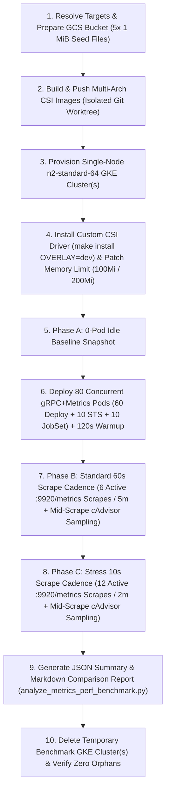

# GCSFuse CSI Driver Metrics Performance & Memory Analysis Skill

This skill provides a standardized, end-to-end workflow for measuring and comparing the memory consumption, OOMKill behavior, CPU overhead, and Prometheus scrape performance of the GCSFuse CSI Driver (`gcsfusecsi-node` DaemonSet, container `gcs-fuse-csi-driver`) when gRPC client protocol and gRPC metrics (`client-protocol=grpc,metrics:experimental-enable-grpc-metrics:true`) are enabled across **80 concurrent pods on a single GKE node**.

It supports benchmarking any CSI driver git branch, commit, or uncommitted working tree (`WORKTREE`), comparing multiple branches or container memory limits (`100Mi` GKE Managed limit vs. `200Mi` OSS manifest default) side-by-side in parallel, and optionally benchmarking against a GKE Managed CSI Driver baseline cluster (`--addons=GcsFuseCsiDriver`).

## Helper Scripts
- **[`scripts/run_metrics_perf_benchmark.sh`](scripts/run_metrics_perf_benchmark.sh)**: End-to-end orchestrator that prepares the GCS bucket and 5x `1 MiB` seed files, builds and pushes multi-arch CSI images from isolated git worktrees, provisions single-node `n2-standard-64` GKE clusters, installs and patches the CSI driver memory limit, runs the 3-phase 80-pod benchmark with active `:9920/metrics` scraping and mid-scrape cAdvisor `memory.peak` sampling, runs the Python analyzer, and cleans up temporary clusters.
- **[`scripts/analyze_metrics_perf_benchmark.py`](scripts/analyze_metrics_perf_benchmark.py)**: Telemetry parser and report generator that computes summary statistics (`mean`, `std`, `min`, `p50`, `p95`, `max`) across Phase A (0-pod idle), Phase B (`60s` scrape cadence), and Phase C (`10s` stress scrape cadence) and outputs both `metrics_resource_impact_summary.json` and `metrics_comparison_report.md`.



---

## Critical Benchmarking Rules

> [!IMPORTANT]
> **1. Active `:9920/metrics` Scraping is Mandatory for Custom CSI Builds**
> When a custom CSI driver is installed via `make install OVERLAY=dev`, the `gcsfusecsi-node` pod only runs `csi-driver-registrar` and `gcs-fuse-csi-driver` — it does **not** deploy the GKE-managed `gcsfusecsi-metrics-collector` container (`otel-collector`) that periodically scrapes `localhost:9920/metrics` in GKE Managed clusters.
> Without explicit HTTP requests to `:9920/metrics`, the CSI driver's metric gathering and export pipeline is never triggered and memory consumption will remain flat at idle levels (`~15–20 MiB`). [`scripts/run_metrics_perf_benchmark.sh`](scripts/run_metrics_perf_benchmark.sh) actively scrapes `/api/v1/namespaces/<ns>/pods/<csi-pod>:9920/proxy/metrics` during every sample in Phase A, Phase B (`60s` interval), and Phase C (`10s` interval).

> [!IMPORTANT]
> **2. Mid-Scrape cAdvisor `memory.peak` Sampling (`1.5s` Interval) Prevents Lost OOM Peaks**
> When an unstreamed CSI driver (`main` or GKE Managed baseline) is scraped under an 80-pod gRPC workload (`~430,000` Prometheus time series / `~155–162 MiB` uncompressed payload), a single `:9920/metrics` scrape can trigger a kernel cgroup OOMKill mid-request. When the container restarts, its cgroup is recreated and `container_memory_max_usage_bytes` (`memory.peak`) resets to `~15 MiB`.
> To capture the true pre-OOM memory spike, [`scripts/run_metrics_perf_benchmark.sh`](scripts/run_metrics_perf_benchmark.sh) runs a background cAdvisor sampler every `1.5s` while the `:9920/metrics` HTTP request is in flight.

> [!NOTE]
> **3. Container Memory Limit Parity (`100Mi` GKE Managed vs. `200Mi` OSS Default)**
> - GKE Managed clusters configure `gcs-fuse-csi-driver` with a **`100Mi`** memory limit (`GOMEMLIMIT=95MiB` via the downward API).
> - OSS `deploy/base/node/node.yaml` configures `gcs-fuse-csi-driver` with a **`200Mi`** memory limit (`GOMEMLIMIT=190MiB`).
> - By default, [`scripts/run_metrics_perf_benchmark.sh`](scripts/run_metrics_perf_benchmark.sh) patches `ds/gcsfusecsi-node` to **`100Mi`** (matching GKE Managed production constraints) unless a different `<mem_limit>` (such as `200Mi`) is specified in `--target <label>:<git_ref>:<mem_limit>`.

---

## Phase 1: Prerequisites & Target Specification

### 1.1 Verify Local Environment & Credentials
Ensure `gcloud`, `kubectl`, `docker` (with `buildx`), `jq`, `go`, and `python3` are installed and authenticated:
```bash
gcloud auth list
kubectl version --client
jq --version
python3 --version
```

### 1.2 Choose Target Specification(s) (`--target`)
Each `--target` flag follows the format:
```text
<label>:<git_ref>[:<mem_limit>[:<staging_version>]]
```
- **`<label>`**: Short identifier used in cluster naming and report columns (e.g., `candidate`, `main-100m`, `main-200m`, `seq-mounts`, `seq-families`).
- **`<git_ref>`**: Any valid git branch, tag, or commit SHA in `gcs-fuse-csi-driver`, or **`WORKTREE`** (or `.`) to build directly from the current working directory (including uncommitted local changes). For any ref other than `WORKTREE`, the script uses a temporary `git worktree` so your active checkout is never disturbed.
- **`<mem_limit>`** *(optional, default `100Mi`)*: Memory limit patched onto the `gcs-fuse-csi-driver` container in `ds/gcsfusecsi-node` (e.g., `100Mi` or `200Mi`).
- **`<staging_version>`** *(optional)*: Explicit image tag in `${REGISTRY}`. If omitted, auto-generated as `v999.999.999-<label>-<short_sha>`.

---

## Phase 2: Running the End-to-End Benchmark

### 2.1 Common Execution Patterns

#### Pattern A: Benchmark Current Working Tree (or Branch) at `100Mi`
To evaluate the currently checked-out CSI driver code (including uncommitted edits) under the GKE Managed `100Mi` memory limit:
```bash
bash .agents/skills/metrics-perf-analysis/scripts/run_metrics_perf_benchmark.sh \
  --project gcs-fuse-test \
  --zone us-west1-a \
  --target "candidate:WORKTREE:100Mi" \
  all
```

#### Pattern B: Compare a Candidate Branch Against `origin/main` (`100Mi` & `200Mi`) and GKE Managed Baseline
To run a multi-cluster parallel comparison across the GKE Managed CSI Driver (`100Mi`), `origin/main` (`100Mi` and `200Mi`), and one or more candidate branches:
```bash
bash .agents/skills/metrics-perf-analysis/scripts/run_metrics_perf_benchmark.sh \
  --project gcs-fuse-test \
  --zone us-west1-a \
  --bucket gcs-fuse-test-csi-metrics-e2e \
  --registry us-west1-docker.pkg.dev/gcs-fuse-test/csi-dev \
  --include-managed-baseline \
  --target "main-100m:origin/main:100Mi" \
  --target "main-200m:origin/main:200Mi" \
  --target "seq-mounts:stream-mounts-sequentially:100Mi" \
  --target "seq-families:stream-families-individually:100Mi" \
  all
```

### 2.2 Step-by-Step Stage Execution (For Debugging or Iterative Runs)
If you want to inspect the clusters interactively or re-run measurements without rebuilding images or recreating clusters, invoke individual subcommands with a fixed `--work-dir`:

1. **Prepare GCS Bucket & 5x `1 MiB` Seed Files**:
   ```bash
   export WORK_DIR="/tmp/csi-metrics-perf-run"
   bash .agents/skills/metrics-perf-analysis/scripts/run_metrics_perf_benchmark.sh \
     --work-dir "${WORK_DIR}" \
     --target "candidate:WORKTREE:100Mi" \
     prepare-bucket
   ```

2. **Build & Push Multi-Arch CSI Images**:
   ```bash
   bash .agents/skills/metrics-perf-analysis/scripts/run_metrics_perf_benchmark.sh \
     --work-dir "${WORK_DIR}" \
     --target "candidate:WORKTREE:100Mi" \
     build
   ```
   *(Add `--build-gcsfuse-from-source --gcsfuse-tag <tag-or-branch>` if you also need to build a custom `gcsfuse` binary from source rather than using `cmd/sidecar_mounter/gcsfuse_binary`.)*

3. **Create Single-Node `n2-standard-64` GKE Cluster(s) & Install CSI Driver**:
   ```bash
   bash .agents/skills/metrics-perf-analysis/scripts/run_metrics_perf_benchmark.sh \
     --work-dir "${WORK_DIR}" \
     --target "candidate:WORKTREE:100Mi" \
     create-clusters
   ```

4. **Deploy 80-Pod gRPC+Metrics Workload & Measure Phases A, B (`60s`), and C (`10s`)**:
   ```bash
   bash .agents/skills/metrics-perf-analysis/scripts/run_metrics_perf_benchmark.sh \
     --work-dir "${WORK_DIR}" \
     --target "candidate:WORKTREE:100Mi" \
     deploy-and-measure
   ```

5. **Analyze Telemetry & Generate Reports**:
   ```bash
   bash .agents/skills/metrics-perf-analysis/scripts/run_metrics_perf_benchmark.sh \
     --work-dir "${WORK_DIR}" \
     --target "candidate:WORKTREE:100Mi" \
     analyze
   ```

6. **Clean Up Temporary GKE Clusters**:
   ```bash
   bash .agents/skills/metrics-perf-analysis/scripts/run_metrics_perf_benchmark.sh \
     --work-dir "${WORK_DIR}" \
     --target "candidate:WORKTREE:100Mi" \
     cleanup
   ```

---

## Phase 3: Interpreting Results & Reference Baselines

### 3.1 Generated Artifacts in `${WORK_DIR}`
After `analyze` completes, inspect:
- **`${WORK_DIR}/metrics_comparison_report.md`**: Ready-to-share Markdown tables comparing Phase A (Idle), Phase B (`60s` scrape cadence), and Phase C (`10s` stress scrape cadence).
- **`${WORK_DIR}/metrics_resource_impact_summary.json`**: Complete statistical breakdown (`mean`, `std`, `min`, `p50`, `p95`, `max`, `raw_samples`) for all CSI containers, sidecars, node resources, scrape latencies, payload sizes, and schema audits.
- **`${WORK_DIR}/data/<cluster>/csi_driver_logs.txt`**: Tail of `gcs-fuse-csi-driver` container logs for diagnosing scrape timeouts or errors.

### 3.2 Reference 80-Pod Benchmark Baselines (`n2-standard-64`, `~430k–443k` Series / Scrape)

Use the reference measurements below (collected on GKE `1.36.4-gke.2046003` with 80 concurrent gRPC + metrics pods generating `~413,000–443,000` Prometheus series / `~150–162 MiB` uncompressed text per scrape) to evaluate new CSI changes:

| Metric (`gcs-fuse-csi-driver`) | GKE Managed (`100Mi`) | `main` (`100Mi` / `95MiB` GOMEMLIMIT) | `main` (`200Mi` / `190MiB` GOMEMLIMIT) | `stream-mounts-sequentially` (`100Mi`) | `stream-families-individually` (`100Mi`) |
| :--- | :--- | :--- | :--- | :--- | :--- |
| **Phase B (`60s`) Working Set Mean / Max** | 39.26 / **73.68 MiB** *(OOM reset)* | 26.86 / **33.48 MiB** *(OOM reset)* | 162.23 / **175.76 MiB** | 46.81 / **48.34 MiB** | **43.68 / 45.59 MiB** |
| **Phase B (`60s`) Kernel Cgroup `memory.peak`** | **98.95 MiB** (`98.95%` of `100Mi`) | **100.00 MiB** (`100%` of `100Mi`) | **188.02 MiB** (`94.01%` of `200Mi`) | **53.81 MiB** (`53.81%` of `100Mi`) | **51.25 MiB** (`51.25%` of `100Mi`) |
| **Phase B (`60s`) OOMKills / Failed Scrapes** | **3 OOMKills** (0/6 failed) | **3 OOMKills** (4/6 failed) | 0 OOMKills (0/6 failed) | **0 OOMKills** (0/6 failed) | **0 OOMKills** (0/6 failed) |
| **Phase C (`10s`) Working Set Mean / Max** | 35.89 / **60.96 MiB** *(OOM reset)* | 35.61 / **44.16 MiB** *(OOM reset)* | 170.10 / **179.70 MiB** | 49.25 / **50.18 MiB** | **46.12 / 46.75 MiB** |
| **Phase C (`10s`) Kernel Cgroup `memory.peak`** | **98.40 MiB** (`98.40%` of `100Mi`) | **100.02 MiB** (`100%` of `100Mi`) | **199.97 MiB** (`99.99%` of `200Mi`) | **56.45 MiB** (`56.45%` of `100Mi`) | **52.41 MiB** (`52.41%` of `100Mi`) |
| **Phase C (`10s`) Cumulative OOMKills / Failed Scrapes** | **5 OOMKills** (0/12 failed) | **5 OOMKills** (8/12 failed) | 0 OOMKills (0/12 failed) | **0 OOMKills** (0/12 failed) | **0 OOMKills** (0/12 failed) |
| **Phase B / C Peak CPU (`mCPU`)** | 127.6m / **766.9m** | 332.9m / **3,856.8m** | 594.4m / **2,006.6m** | 281.3m / **317.6m** | **129.8m / 161.8m** |
| **`:9920/metrics` Mean Scrape Duration (`60s` / `10s`)** | 5,021 / 3,477 ms | 5,205 / 6,959 ms | 3,345 / 3,012 ms | 4,698 / 4,337 ms | **2,995 / 2,878 ms** |

---

## Verification Checklist

Before completing a metrics performance analysis task, verify:
- [ ] Active `:9920/metrics` scrapes (`scrape_meta.jsonl`) were executed during Phase B (`6` samples) and Phase C (`12` samples), confirming non-zero series counts (`~400,000+` series for 80 active gRPC pods) on successful scrapes.
- [ ] Kernel cgroup v2 `memory.peak` (`container_memory_max_usage_bytes` from `cadvisor_*.prom`) was captured via mid-scrape `1.5s` sampling in addition to Kubelet `/stats/summary` Working Set and RSS.
- [ ] Container memory limit on `ds/gcsfusecsi-node` (`gcs-fuse-csi-driver`) was verified (`100Mi` for GKE Managed parity, or `200Mi` when testing OSS default limits).
- [ ] User's local git working tree in `gcs-fuse-csi-driver` remains on its original branch with all uncommitted changes intact.
- [ ] All temporary benchmark GKE clusters were deleted (`gcloud container clusters list --project=<project>` confirms no leftover `<cluster-prefix>-*` clusters).
